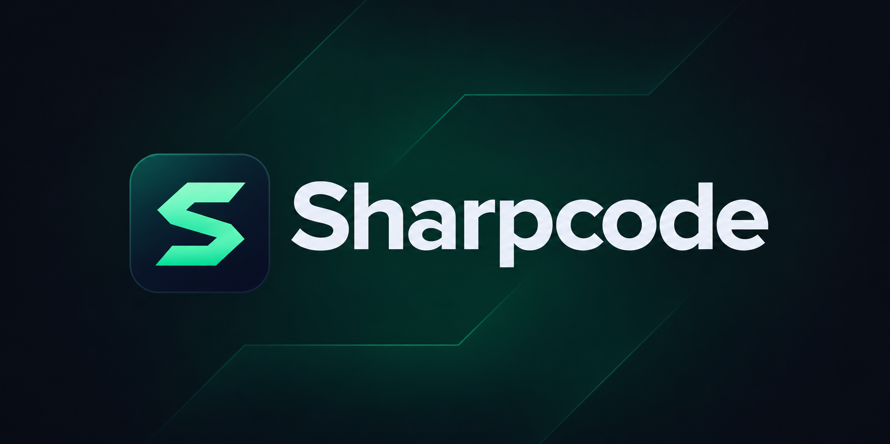

# Sharpcode



Sharpcode is a native desktop code editor built with .NET 10, C#, Avalonia, and AvaloniaEdit. It runs on Windows, Linux, and macOS. The workbench pairs a folder explorer and tabbed editor with workspace search, Git status, local command output, and a coding agent.

[Brand artwork and icon formats](assets/branding/README.md)

## Build and run

Install the .NET 10 SDK and initialize the two pinned submodules from the Sharpcode checkout.

```sh
git submodule update --init
dotnet build Sharpcode.slnx --configuration Release
dotnet run --project src/Sharpcode
```

Pass a folder or text file after `--` to open it on launch.

```sh
dotnet run --project src/Sharpcode -- /path/to/project
```

Git supplies the quick-open index and source-control commands. Sharpcode can browse and search ordinary folders without Git. If `rg` is on PATH, workspace search uses ripgrep. See [Avalonia’s supported platforms](https://docs.avaloniaui.net/docs/supported-platforms) for desktop and Linux dependencies.

## Find your way around

- Use **File → Open Recent** or the folder name in the toolbar to switch workspaces. The start screen also shows recent folders.
- Open **Quick Open** with Ctrl+P or ⌘P. Search by file name or path, or type `>` to run a command from the same box.
- Click a folder row to expand or collapse it, or click a file to open it. In workspace search, use Down to browse matches or Enter to jump to the first match.
- The explorer bundles [Material Icon Theme artwork](src/Sharpcode/Assets/Material/NOTICE.md) for common languages, config files, and project folders.
- Right-click in the editor for clipboard commands, find and replace, line comments, navigation, and agent actions for the active file or selection.
- Use the toolbar to show the sidebar or agent. Narrow windows show one side panel at a time, and Sharpcode remembers which panels you have enabled.

## Appearance

Open **View → Appearance**, or press **Ctrl+,** on Windows and Linux or **⌘,** on macOS. Choose Dark, Light, Midnight, or Follow System. You can set a preset or custom hex accent and adjust the editor font size.

Choose a PNG, JPEG, WebP, or BMP up to 24 MB for the editor background. **Fill** covers the editor and may crop the image. **Fit** shows the entire image. Adjust opacity to keep code legible. Changes preview as you go. **Save** keeps them across launches, and **Cancel** restores your saved appearance. Sharpcode keeps a local copy of the selected image in its settings directory.

## Source control

Open the **Git** tab or press **Ctrl+Shift+G** to use your installed Git CLI. The panel can initialize the open folder or clone from a GitHub HTTPS or SSH URL.

1. Filter changes by file name or path. Select a file and press **Enter**, or click the row, to open its diff in the editor area. Use **+** or **−** on a row, the action in the diff header, or **Stage All** and **Unstage All** for the whole repository.
2. Enter a message and click **Commit**, or press **Ctrl+Enter** (**⌘Return** on macOS) in the message field. Staging uses saved file contents. Commits use your configured Git author and signing settings.
3. Use **Add Remote** with the URL of an existing GitHub repository. **Publish Branch** establishes tracking. The remote button then offers **Fetch**, **Pull**, or **Push** based on the branch's last known upstream status. Fetch updates the ahead and behind counts.
4. Use the branch button to switch branches and **Git actions** to create branches, choose remote actions, or view recent commits. Pull uses fast-forward only. Save open changes before switching or pulling.

Remote actions use your Git credential helper or SSH agent. [GitHub authentication for Git](https://docs.github.com/en/authentication/keeping-your-account-and-data-secure/about-authentication-to-github)

## Work with a model

Open **Agent → Provider Settings**. Select a provider, enter an API key or use the corresponding environment variable, and enter a model identifier. **Find Models** queries the configured server if it supports model discovery. Keys entered in the app are kept in memory for the current session.

| Provider | Default base URL | Environment variable |
| --- | --- | --- |
| OpenAI | `https://api.openai.com/v1` | `OPENAI_API_KEY` |
| Claude | `https://api.anthropic.com/v1` | `ANTHROPIC_API_KEY` |
| OpenAI-compatible | `http://localhost:11434/v1` | `SHARPCODE_API_KEY` if the server requires one |
| LM Studio | `http://localhost:1234/v1` | `LM_STUDIO_API_TOKEN` if server authentication is enabled |

OpenAI and compatible providers use streaming Chat Completions. Claude uses the streaming Messages API. For LM Studio, start its local server and choose the model identifier shown in LM Studio. Repository tools require a model and server that support function calling. [OpenAI Chat Completions](https://developers.openai.com/api/reference/chat-completions/overview) · [Claude Messages](https://platform.claude.com/docs/en/api/messages) · [LM Studio API](https://lmstudio.ai/docs/developer/openai-compat)

- **Ask**, the default mode, can list files, search source, and read line ranges. The attachment control names the active file and adds the current selection or text near the cursor.
- **Edit files** can draft exact-text replacements and new files across the workspace. Follow-up prompts can refine pending drafts. Select a draft and click **Review Diff** to apply or discard it. Sharpcode checks the on-disk version and any open unsaved buffer before applying it.
- If a request fails or is stopped, Sharpcode returns the prompt to the composer when it is empty so you can retry or edit it.
- **Suggest Code at Cursor** requests a completion on demand. Review the suggestion and use **Insert** or **Tab** to accept it.
- **Local Commands** runs commands you enter directly. It shows output and exit status and offers a stop button. Agent tools operate on workspace text and draft changes.

Prompts and the workspace context used by the agent go to the configured endpoint. Chat stays in memory by default. On Windows and Linux, the optional history setting uses [AgentSpace](https://github.com/jihadkhawaja/AgentSpace) to keep up to 12 completed turns per folder for seven days. macOS uses session-only history.

The command palette includes **Git · Scan Commits with BusinessHarness**. It runs the [BusinessHarness](https://github.com/jihadkhawaja/BusinessHarness) CLI’s local scan against a base ref you choose. Install its .NET tool and make it available on PATH to use this command. The pinned source checkout is under `external/BusinessHarness`.

## Keyboard shortcuts

| Action | Windows and Linux | macOS |
| --- | --- | --- |
| Quick Open | Ctrl+P | ⌘P |
| Command Palette | Ctrl+Shift+P / F1 | ⇧⌘P / F1 |
| Open File | Ctrl+O | ⌘O |
| Open Folder | Ctrl+K, Ctrl+O | ⌘K, ⌘O |
| Save / Save As | Ctrl+S / Ctrl+Shift+S | ⌘S / ⇧⌘S |
| Close Editor | Ctrl+W | ⌘W |
| Next Editor | Ctrl+Tab | Ctrl+Tab |
| Find / Replace in File | Ctrl+F / Ctrl+H | ⌘F / ⌥⌘F |
| Search Workspace | Ctrl+Shift+F | ⇧⌘F |
| Toggle Sidebar | Ctrl+B | ⌘B |
| Appearance | Ctrl+, | ⌘, |
| Toggle Line Comment | Ctrl+/ | ⌘/ |
| Go to Line | Ctrl+G | Ctrl+G |
| Local Commands | Ctrl+Backtick | Ctrl+Backtick |
| Focus Agent | Ctrl+Alt+I | ⌃⌘I |
| Agent Suggestion | Ctrl+Alt+Space | ⌘⌥Space |
| Send Agent Prompt | Ctrl+Enter | ⌘Return |

## Large workspaces

The explorer loads directories on expansion and pages long listings. Quick Open uses a short-lived Git-aware path index, and workspace search is cancellable. AvaloniaEdit virtualizes the visible text. Files are decoded and indexed off the UI thread. The editor supports text files up to 64 MiB and uses plain rendering for large documents. Workspace search covers files up to 8 MiB. Agent reads cover text files up to 1 MiB, with bounded line ranges, search results, and tool calls.

Sharpcode handles UTF-8 and BOM-marked UTF-16/32. It preserves encoding and line endings when saving. The current workbench provides syntax highlighting, text navigation, and model-assisted completion. Semantic language-server features, debugging, and VS Code extensions are outside the current implementation.

## Test and publish

```sh
dotnet test Sharpcode.slnx --configuration Release
dotnet publish src/Sharpcode --configuration Release --runtime win-x64 --self-contained true -o artifacts/publish/win-x64
```

Use `linux-x64` or `osx-arm64` for the other desktop targets. Run `Sharpcode.exe` on Windows or `./Sharpcode` on Linux or macOS from the published directory. The desktop workflow builds, tests, and archives each platform on its corresponding GitHub Actions runner. The macOS artifact contains an unsigned, unnotarized `Sharpcode.app` bundle. [Avalonia macOS deployment](https://docs.avaloniaui.net/docs/deployment/macos)

## License

Sharpcode is released under the [MIT License](LICENSE). Third-party assets and submodules carry their own licenses.
